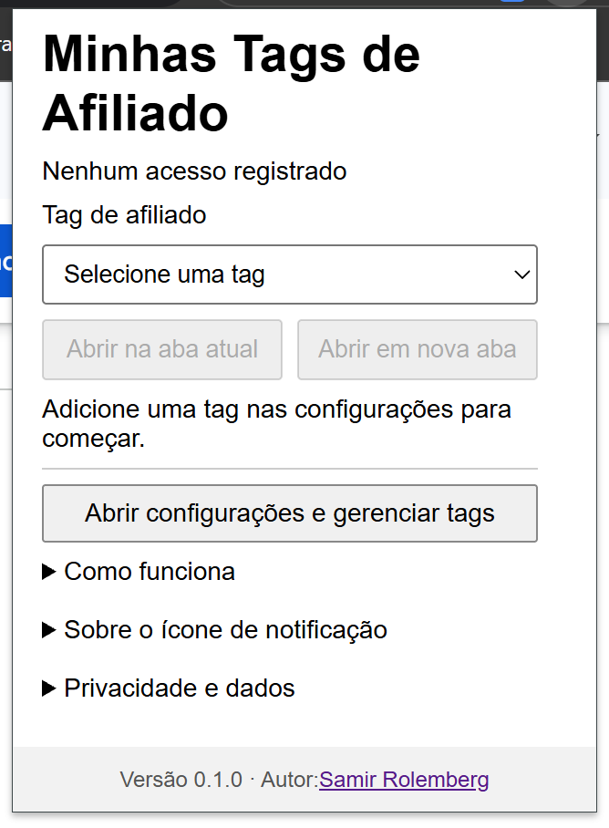

# My Affiliate Tags

A Chrome extension for detecting, storing, and managing URLs with a `tag` parameter on supported Amazon store domains and their subdomains. Redirect, short-link, and non-store service domains are not treated as stores. Each saved tag stores its key, original URL, and optional description in the browser. The most recent tag access and its time are stored once as a separate global record.



## Artificial intelligence disclaimer

Artificial intelligence tools were used as supervised aids during development. Their suggestions were reviewed, directed, and validated by a human maintainer; they do not operate or make decisions independently for this project. AI-assisted code and documentation may still contain errors, so review and test changes before using or distributing the extension. Use of the extension and affiliate links is the user's responsibility and must comply with Amazon's terms and applicable laws.

## Installation

1. Clone or download this project.
2. In Chrome, open `chrome://extensions`.
3. Enable **Developer mode**.
4. Click **Load unpacked** and select the project folder.
5. Pin the extension to the toolbar to access its popup.

To enable Chrome API definitions in your editor, run `npm install`. This step is optional for using the extension.

To create a ZIP containing only the extension files needed for distribution, run `npm run package:extension` on Windows or `npm run package:extension:sh` where POSIX shell and `zip` are available. The archive is written to `release/my-affiliate-tag-manager-v<version>.zip`; it excludes tests, development dependencies, documentation, and source artwork. Both package scripts combine `tag-utils.js` into the service worker so the distributed worker has no script-loading instruction.

## Tests

Run all tests with `npm test`. The unit tests use Node.js's built-in test runner; the Puppeteer smoke test also launches the bundled Chromium browser, loads the unpacked Manifest V3 extension, checks its service worker and manifest, and exercises invalid/valid tag entry and popup rendering. Run only the browser smoke test with `npm run test:extension`. Installing dependencies with `npm install` downloads Puppeteer's compatible browser if it is not already available.

## Popup and notification badge

The popup is available on every page and displays the most recently accessed key and its date/time, a saved-tag selector, buttons to open the selected original URL in the current or a new tab, and a link to tag management. Opening a saved URL records that key and the access time. If there are no saved tags, the popup directs you to settings. Collapsed help sections explain how the extension works, the toolbar badge states, and privacy/data handling. The shared footer shows the extension version and links the author's name to the project source.

The toolbar badge indicates URL/key status independently of the popup content: a green check (U+2713) means a valid saved URL's key matches the latest accessed key; an exclamation mark (U+0021) means the valid saved URL has a different key or the key is inferred from a recent access on a supported Amazon URL without a `tag` parameter; and a cross mark (U+2717) means the URL has an invalid, unsaved, or expired inferred key. Inferred status expires after 24 hours, and an alarm refreshes the badge at that time. The badge is hidden on unsupported domains.

## Tag management

On the options page, you can:

- Add a record using its required original URL and an optional description. The key is derived from the URL's single `tag` parameter; the URL must be a valid HTTP(S) URL on a supported Amazon domain. URLs with multiple distinct `tag` values are rejected.
- If the URL derives a key already in the list, adding is disabled and an error appears below the URL field.
- Edit descriptions and original URLs in a batch using **Save changes**. The displayed key is read-only and changes when the URL is edited; the URL must remain valid and the derived key unique. Invalid or duplicate URLs show an error below the field and block saving.
- Delete an individual tag after confirmation.
- Delete all tags after two confirmations.
- Import a JSON file or export the current list.
- Shows the extension version and a project link labeled with the author's name in the shared light-gray footer.

After a supported Amazon page's main-frame navigation completes, its tag and full URL are saved. The global last-access record is updated for a completed navigation or when a saved URL is opened from the popup. Switching focus to an already open tab does not update access time. Existing per-tag access timestamps are consolidated to the latest one when migrating stored data. The global access record is shown only in the popup and is not included in exports. Tag keys remain unique. Existing records without a saved URL remain compatible; a later completed navigation can populate it, or it can be entered in tag management.

## JSON import and export

The exported file uses this format:

```json
{
  "version": 1,
  "tags": [
    {
      "tag": "example-20",
      "description": "My account",
      "url": "https://www.amazon.com/dp/example?tag=example-20"
    }
  ]
}
```

You can also import an array of strings or records in the form `{ "tag": "...", "description": "...", "url": "..." }`. Older records without URLs remain importable, and any `lastAccessed` value in an imported record is ignored; supplied URLs must be valid HTTP(S) Amazon URLs with exactly one distinct tag matching the record key. Importing merges the data with existing tags and removes duplicates. The description is optional.

## Internationalization

The interface and manifest strings use Chrome's localization system. The default language is set by `default_locale` in `manifest.json`; its messages are in `_locales/pt_BR/messages.json`. English translations are in `_locales/en/messages.json` and are selected automatically when the browser language is English. The manifest uses `__MSG_messageName__` identifiers; HTML files mark text with `data-i18n` and accessible attributes with `data-i18n-aria-label`, which are applied by `i18n.js`. Scripts use `chrome.i18n.getMessage()`.

To add another language, create a folder in `_locales` using the corresponding language code and add a `messages.json` file with the same message identifiers.

## License

This project is distributed under the MIT License. See [LICENSE](LICENSE) for details.

## Permissions

- `activeTab`: accesses the active tab when the user interacts with the extension.
- `tabs`: reads the tab URL and tracks navigation and tab changes.
- `storage`: stores tags locally in the browser.
- `webNavigation`: detects successfully completed main-frame navigations so access timestamps are not changed by tab focus alone.
- `alarms`: refreshes the badge when the inferred key's 24-hour access window expires.

## Main files

- `manifest.json`: Manifest V3 configuration and permissions.
- `background.js`: service worker that captures URLs and access times during navigation, updates the badge, and serializes list changes.
- `popup.html` / `popup.js`: interface for viewing last access and opening saved URLs.
- `options.html` / `options.js`: interface for tag and URL maintenance plus JSON import/export.
- `tag-utils.js`: shared tag normalization/merging, Amazon URL parsing, and URL/tag validation.
- `amazon_store_domains.json`: domain catalog checked against the runtime allowlist by the unit tests; it is not loaded by the extension.
- `i18n.js`: localizes marked page content and provides shared error formatting for UI scripts.
- `_locales/`: localized strings for the supported languages.
